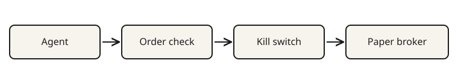

# agent-order-check

Check one proposed order against a limits file the agent cannot write. The result is PASS or SEND-BACK.

[](LICENSE)
[](https://github.com/thetahustler/agent-order-check/actions/workflows/test.yml)

Built by The Agentic Trader (JP3 Labs).

The rules are the ones on the [Agent Order Check](https://theagentictrader.com/check?utm_source=github&utm_campaign=agent-order-check). This package does not add a trading rule, and it does not place an order.

## Not financial advice / paper first

Educational only. Not financial advice. A PASS means the order is complete and inside the limits file. It says nothing about whether the trade is a good idea. Start on paper. `account_type` `live` is refused unless you explicitly enable it, and the default is refuse. `LIVE_TRADING` in the limits file stays `off`.

## Flow



The agent proposes an order. This check reads it. The kill switch can block it. A PASS is what you may hand to a paper broker.

## Quickstart

```bash
git clone https://github.com/thetahustler/agent-order-check.git
cd agent-order-check
bun src/cli.ts --limits examples/limits.json examples/pass-order.json
```

`bun test` runs the tests. Node 22 or newer can run the same file:

```bash
node --experimental-strip-types src/cli.ts --limits examples/limits.json examples/pass-order.json
```

Pipe JSON on stdin if you do not want to write the order to a file:

```bash
bun src/cli.ts --limits examples/limits.json < examples/pass-order.json
```

Exit 0 is PASS. Exit 1 is SEND-BACK. Exit 2 means the check did not run, because a path was missing or an argument was wrong.

## Sample output

PASS, from `examples/pass-order.json` and `examples/limits.json`:

```json
{
  "verdict": "PASS",
  "reasons": []
}
```

The CLI also prints each check. On this order the dollar-risk line is `Dollar risk $40 is within your $50.` Max loss is the `50` in the limits file. The order does not get to raise it.

SEND-BACK, from `examples/send-back-order.json`:

```json
{
  "verdict": "SEND-BACK",
  "reasons": [
    "Asset type is missing. Futures, options and stock carry different risk per point, so the checker will not assume one.",
    "Time in force is missing. Brokers default differently, and an order that rests past the close is a surprise.",
    "The stop is beyond the entry on a buy. A buy needs the stop below the entry.",
    "A buy bracket needs take_profit above the entry and the entry above the stop.",
    "Asset type unknown, so the multiplier is unknown. Dollar risk is price distance times multiplier times quantity. Do not guess the multiplier. The order's own max_loss was ignored. Limits live in your file, not on the order.",
    "The order says it turns LIVE_TRADING on. An order cannot change your limits. Only your own file can."
  ]
}
```

That order also carries `"max_loss": "1000"`. The checker ignores it.

## What's new

### 2026-10-20

First release. The order checks from the page above, as a TypeScript library and a CLI that runs on Bun and Node. A kill switch blocks every order. A live account type is refused unless you enable it.

## What it checks

On the order: symbol, side, quantity, asset type, order type, time in force, a stop, the stop's side and distance, bracket legs, dollar risk against the max loss in the limits file, and that the order does not change `LIVE_TRADING` or human approval.

On the limits file: `LIVE_TRADING` is off, human approval is on, max loss per trade is a number, max loss per day is a number at least that large, max open positions is a whole number, a never-trade list is present, and a kill switch is named.

Dollar risk is the distance from the entry to the stop, times the multiplier, times the quantity. Equity and crypto spot use a multiplier of 1. An option with no multiplier uses 100, and the reason says so. A future or fx order with no multiplier is SEND-BACK. The checker does not guess one.

Field names match the page, including `qty`, `type`, `limit_price`, `time_in_force`, `stop_loss.stop_price`, and `take_profit.limit_price`. Common aliases work. TradeStation names work too: `Symbol`, `Quantity`, `OrderType`, `TradeAction`, `LimitPrice`, `StopPrice`, `TimeInForce.Duration`, and a `BRK` group under `OSOs`.

`account_type` is `paper` or `live`. Put it on the order.

## Kill switch

The switch sits outside the agent. The agent can read it and should not be able to write it.

- `TRADING_HALT=1` blocks every order. `true`, `yes`, and `on` do the same. Unset does not.
- A halt file blocks every order while the file exists. Point at it with `--halt-file` or `TRADING_HALT_FILE`. Removing the file is what turns that switch off.

A tripped switch is SEND-BACK and does not score the order:

```json
{
  "verdict": "SEND-BACK",
  "reasons": ["Kill switch is on. New orders are blocked."]
}
```

The named `kill_switch` inside the limits file is a different check. It records who can stop the process. It does not, by itself, block an order. The env flag and the halt file do.

## Paper first

`account_type` `live` is SEND-BACK unless you enable it:

```bash
ALLOW_LIVE=1 bun src/cli.ts --limits examples/limits.json order.json
```

`--allow-live` is the same switch. In the library, pass `{ allowLive: true }`. Anything else, including an unset variable, refuses live.

The limits file still has to say `"live_trading": "off"`. Turning that field on is SEND-BACK. An order that sets `live_trading` to `on` is SEND-BACK too. The enable switch does not let the order rewrite the file.

## Library

```ts
import { readFileSync } from "node:fs";
import { checkProposedOrder } from "agent-order-check";

const limits = JSON.parse(readFileSync("limits.json", "utf8"));
const result = checkProposedOrder(order, limits);
if (result.verdict !== "PASS") {
  // Do not call the broker. result.reasons says why.
}
```

There are no runtime dependencies. Bun imports the TypeScript source. Node 22 or newer can load it with type stripping.

## Examples

- `examples/pass-order.json` and `examples/send-back-order.json` are the two CLI orders. `examples/limits.json` is the limits file.
- [`examples/call.py`](examples/call.py) calls the CLI from Python.
- [`examples/tradingagents.md`](examples/tradingagents.md) places the check between an agent decision and the broker call. Their project is [TradingAgents](https://github.com/TauricResearch/TradingAgents). This repo does not include their code.

## Tests

```bash
bun test
```

The tests cover a PASS, a SEND-BACK, the kill switch, and the live refusal.

## License

Apache-2.0. See [LICENSE](LICENSE).
